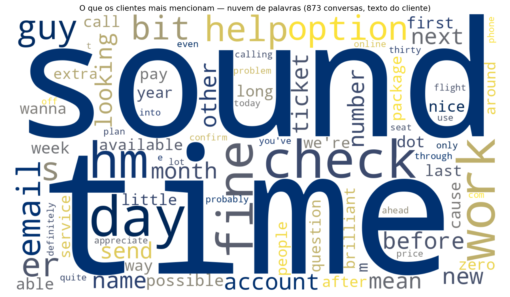
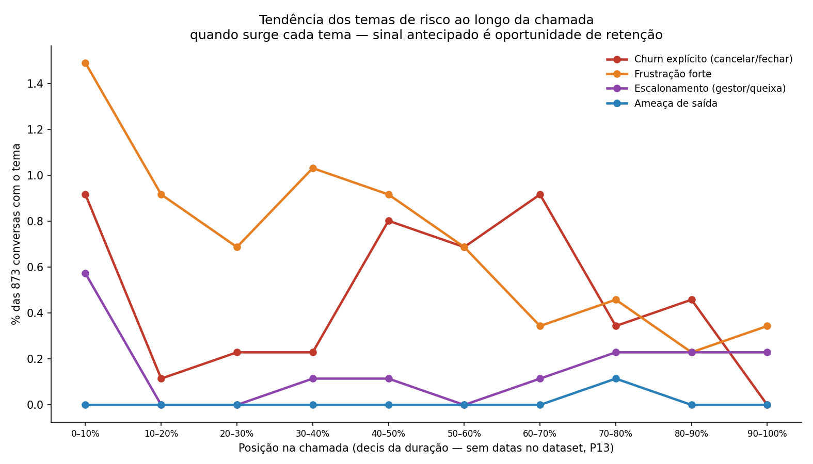
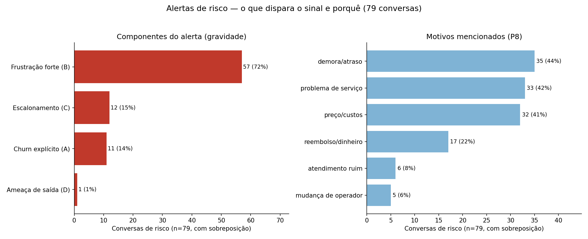

# Previsão de Churn em Call Center — Áudio de Clientes (AppTek)

Pipeline end-to-end de previsão de **risco de churn** a partir de áudio real de call center — dataset público [AppTek Callcenter Dialogues](https://huggingface.co/datasets/apptek-com/apptek_callcenter_dialogues) (CC BY-SA 4.0): 873 conversas role-played, 151,1 h, 16 domínios, 14 acentos, 158 falantes, 94.679 segmentos com diarização. Todos os números foram verificados por execução.

## Resultados

| Avaliação | Métricas |
| --- | --- |
| Hold-out disjunto por falante (42 conversas, 16 vozes nunca vistas) | F1 0,698 · AUC 0,708 · precisão 83,3% · recall 60,0% |
| Out-of-fold 5-fold agrupada por falante (160 conversas) | F1 0,632 · AUC 0,651 · precisão 64,5% · recall 62,0% |
| Evolução com split por falante + tuning | F1 0,552 → 0,698 (eliminou memorização de vozes) |

Modelo: Regressão Logística (C=0,03) sobre 51 features — comportamentais, acústicas e do texto do agente. Uso recomendado: **ranker de priorização** (limiar p ≥ 0,50) — rever as 50% das chamadas mais arriscadas apanha cerca de 2/3 dos casos.

**Achados de negócio** (perguntas P1–P14 no notebook): motivos dominantes — demora/atraso (44%) e falha de serviço (42%); risco por domínio — telecom 22,5% (finance e food ~0%); o cliente em risco interrompe +37%, fala mais (+15%) e responde mais depressa; desculpas do agente acompanham a fricção (+75%); a duração da chamada NÃO prevê churn (r = 0,02); sinais de churn já surgem a ~21% da chamada.

## Gráficos-chave







## Metodologia (anti-leakage)

O label de risco de churn (79/873 = 9,0%) deriva do **texto do cliente** (união de: churn explícito, frustração forte, escalonamento, ameaça de saída — padrões documentados no notebook). O texto do cliente **nunca** entra como feature do modelo: este usa apenas features comportamentais (interrupções, latência, ritmo, turnos), acústicas do cliente (MFCC, RMS, pitch, ZCR, centróide — librosa) e do texto do AGENTE (desculpas, empatia). Split e CV agrupados por falante — o modelo nunca ouve a mesma voz em treino e teste.

## Estrutura do repositório

```
├── README.md
├── LICENSE                     (MIT — código)
├── requirements.txt
├── notebooks/
│   ├── previsao-churn-callcenter-audio-databricks.ipynb   (original, com outputs)
│   └── previsao-churn-callcenter-audio-kaggle.ipynb        (adaptado para Kaggle)
├── data/
│   ├── churn_features_oof_160.csv   (160 conversas, features + label + score OOF)
│   ├── conversas_873.csv            (873 conversas, agregados + label)
│   └── dataset_README.md            (dicionário de dados e crédito)
├── images/                     (3 PNGs dos gráficos-chave)
└── kaggle/                     (metadados para publicação no Kaggle)
```

## Como correr

* **Kaggle**: importar `notebooks/previsao-churn-callcenter-audio-kaggle.ipynb`, internet **ON**, GPU OFF. Aviso: o STEP 7 descarrega 160 WAVs (~2,2 GB) e extrai features acústicas — 30–60 min.
* **Databricks**: importar o notebook Databricks para um workspace (compute serverless).
* **Local**: `pip install -r requirements.txt` e correr os notebooks com Jupyter.

Os CSVs em `data/` permitem explorar os resultados sem reexecutar o pipeline completo (o `churn_score_oof` é a previsão out-of-fold de cada conversa).

## Publicação no Kaggle

* **Dataset** (features, labels e scores OOF): [Previsão de Churn Call Center — Áudio AppTek](https://www.kaggle.com/datasets/gonaldomichael/previso-de-churn-call-center-udio-apptek)
* **Notebook** (pipeline completo, executável no Kaggle): [Previsão de Churn Call Center — Áudio AppTek](https://www.kaggle.com/code/gonaldomichael/previs-o-de-churn-call-center-udio-apptek)

## Licenças e crédito

* **Código**: MIT (ficheiro `LICENSE`).
* **Dados** (fonte e derivados): CC BY-SA 4.0 — atribuição obrigatória a AppTek / Hugging Face; ver `data/dataset_README.md`.

## Limitações

Conversas role-played (não produção); label proxy derivado do texto; features acústicas extraídas de uma amostra estratificada de 160 conversas (as restantes 713 não têm áudio processado); n pequeno → intervalos largos; sem timestamps — análise de horários/datas impossível (P13). Detalhes completos no notebook.
